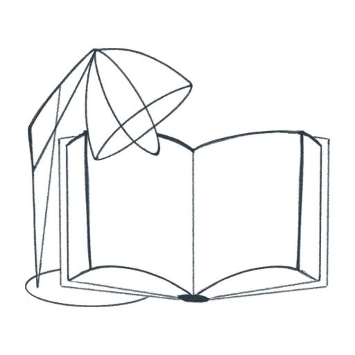

<p align="center"></p>

# Class Is In Session

A free teaching game. You are the teacher. Your ten students are played by AI, and they only know what you taught them. At the end of the lesson they take a quiz from their own notes, so their scores show how well you taught.

The point of the game is to learn a subject by teaching it. Students ask why things work and what would happen if; to answer them you have to understand the topic yourself.

- Runs in a web browser. Nothing to install to play a hosted copy.
- You bring your own AI: a free key from Groq, Google Gemini or OpenRouter, or a model running on your own computer.
- No account, no server. Your key, lessons and scores stay in your browser.
- In English, French, Spanish or Arabic (Settings). Students speak, write and answer in that language; built-in courses are in English.

## What you can do

- Teach built-in courses: **Intro to Python** (variables, if, loops), **Data Structures** (linked lists, stacks, queues, binary trees), **SQL Basics** (SELECT and WHERE, joins, grouping).
- Turn your own **PDFs into courses**: one PDF or several, cut into lessons at chapter starts or into equal parts. The game writes goals and a quiz for each lesson, and you can edit all of it.
- Teach by typing, writing on boards (several, like slides), and, with a model that reads pictures, drawing on them.
- Call on students, ask the class, hear raised hands. Students have different personalities, moods and wrong beliefs. They hear each other, react to each other and remember earlier lessons, including the mistakes you taught them.
- Get a report after each quiz: class average, each student's answers and why they lost points, and three tips.
- Keep a best score per lesson and a score per course. Export and share lessons or whole courses as files.

## Install it as an app

The hosted game can be installed like an app, with its own icon and window:

- **Chrome or Edge on a computer**: the install icon at the right of the address bar, or menu, **Install Class Is In Session**.
- **Android**: menu, **Add to Home screen** or **Install app**.
- **iPhone or iPad (Safari)**: Share, **Add to Home Screen**.

Once opened, the game itself starts without a connection. Teaching still needs your AI provider: online for Groq, Gemini and OpenRouter, or a model on your own computer for fully offline play. A new version is picked up the next time the game is opened online.

## Quick start

You need [Node.js](https://nodejs.org) 20 or newer.

```bash
git clone <this repository>
cd TeacherSim
npm install
npm run dev
```

Open the address it prints (usually http://localhost:5173). The first screen is Settings: choose an AI provider, paste a key, press **Test connection**, then **Save and choose a lesson**.

## Getting an AI key (free)

Pick one. Leave the model box empty in Settings and the game picks a suitable model for you.

| Provider | Speed | Free allowance | Reads pictures | Good for |
|---|---|---|---|---|
| **Groq** | Very fast (1 to 10 seconds a turn) | Generous, but capped per minute | Not detected | The smoothest free play |
| **Google Gemini** | Fast | Generous per day, capped per minute | Yes | Best quality; drawing on the board |
| **OpenRouter** (free models) | Slow (about 40 seconds a call) | About 50 requests a day, roughly one lesson | Some models | Trying many models; paid models with credit |

Limits and model names change. The table is what was seen while building the game.

### Groq

1. Go to [console.groq.com](https://console.groq.com) and sign in.
2. Open **API Keys**, create a key, copy it.
3. In the game: Settings, provider **Groq**, paste the key, **Test connection**.

The free tier limits how much text you can send per minute. When you hit it the game waits a few seconds or switches to another Groq model by itself.

### Google Gemini

1. Go to [aistudio.google.com](https://aistudio.google.com) and sign in.
2. Press **Get API key**, create a key, copy it.
3. In the game: Settings, provider **Google Gemini**, paste the key, **Test connection**.

At busy times Gemini's newest models answer "high demand". The game then falls back to an older Flash model. On the free tier Google may use what you send to improve its products; do not import PDFs you would not share.

### OpenRouter

1. Go to [openrouter.ai](https://openrouter.ai) and sign in.
2. Open **Keys**, create a key, copy it. Set a spend limit on it.
3. In the game: Settings, provider **OpenRouter**, paste the key, **Test connection**.

A new account has no credit, so only models whose name ends in `:free` work. With a few dollars of credit you can pick a fast paid model from the list; a lesson then costs a few cents.

### Keep your key safe

- Paste the key only into the game's Settings screen. Never post it in a chat, a forum or a screenshot.
- The key is kept in your browser only. Untick **Remember key on this device** on a shared computer. **Remove key** deletes it.
- If a key was shown to anyone, delete it at the provider and make a new one.

## Running with a local model (no key, no limits)

The game talks to any server that speaks the OpenAI chat format. A model of about 8 billion parameters or more works best; the game asks for answers in a strict JSON format, and very small models get it wrong.

Because the game is a web page, the model server must allow web pages to call it (this is called CORS). Run the game on the same computer with `npm run dev`.

### Ollama

1. Install [Ollama](https://ollama.com) and pull a model: `ollama pull <model name>`.
2. Allow the game's address before starting Ollama. On Windows (PowerShell):
   ```powershell
   $env:OLLAMA_ORIGINS = "http://localhost:5173"
   ollama serve
   ```
   On macOS or Linux:
   ```bash
   OLLAMA_ORIGINS=http://localhost:5173 ollama serve
   ```
3. In the game: Settings, provider **Ollama (local)**, no key, type the model name you pulled.

### LM Studio

1. Install [LM Studio](https://lmstudio.ai), download a model, load it.
2. Start the local server and turn on **Enable CORS** in the server settings.
3. In the game: Settings, provider **LM Studio (local)**, no key, type the loaded model's name.

### llama.cpp

1. Start `llama-server -m <your model file>`.
2. In the game: Settings, provider **llama.cpp (local)**, no key.

If **Test connection** says it could not reach the address, the server is not running, the port is different, or the server is refusing web pages (the CORS setting above). These local setups were not all tested from a hosted copy of the game; running the game locally is the safe path.

Local models are slower. The first call can take a minute while the model loads.

## How to play

The game has a guide built in: **How to play** on the main menu, **Help** on every screen, and **?** buttons next to the class mood, the notebook and the lesson goals. During your first lessons, tips appear the first time something happens (a raised hand, a restless class); turn them off or back on in Settings.


1. **Choose a lesson** and press **Teach**. Ten students are drawn from a pool of thirty.
1. **Study.** The study screen shows the goals, the study notes and the wrong ideas some students will bring. The quiz stays hidden. During the lesson, **Lesson notes** in the ☰ menu reopens it.
2. **Teach.** Type what you say and press Enter, or press 🎤 and speak (Chrome, Edge, Safari): your words appear in the box and are sent only when you press Say it. Write key points on the board: students copy what they see. You have 20 turns or 15 minutes.
3. **Watch the class.** Each student shows a mood. Click a student to read their notebook. Wrong beliefs they have not dropped are marked. The goals panel shows how many students have each goal in their notes.
4. **Talk with students.**
   - A sentence with a question mark gets an answer from one student.
   - Say a student's name and that student answers.
   - **Call on** and **Ask the class** invite questions when you have typed nothing.
   - Click a desk with a raised hand to hear the student.
5. **Ring the bell.** Students take the quiz from their notes only. You get the report, which also includes:
   - **Your teaching, checked**: anything you said or wrote that was wrong, with the correction (an AI check, it can be wrong).
   - **In their own words**: a typical student explains the lesson back to you from their notebook, and the goals missing from their notes are listed.
   - **Challenge**: whether you met this lesson's teaching challenge (shown in the top bar during class).
   - **Review the lesson**: a turn-by-turn replay with a chart of goals and class mood, and your mistakes pinned to the line where you said them.
   - **Teach a follow-up lesson**: the same class, only the goals they missed, and they now believe the mistakes you made. Correct them.
   - **Share**: a picture of your report card.
6. **Try again** to beat your best score. Lessons where your classes keep missing a goal show it as "Often missed" on the lessons and study screens.

Your **rank** (Student Teacher up to Head of Department) and **badges** grow with lessons taught, scores, challenges met and difficulty. They show on the main menu.

**Difficulty** (Settings): Easy, Normal, Hard, or Inspection, where a correct answer the student's notes do not support gets no marks.

Things that matter for the score:

- Students only know what you said, wrote or drew. Skip a goal and nobody can answer its question.
- Low-attention students miss notes. Bored students miss more. Several turns of lecture with no interaction bore them; questions and examples wake them up.
- A student's wrong answer that you neither confirm nor correct can end up in other notebooks.
- Some students start with wrong beliefs. Correct them clearly or they answer the quiz with them.

Tick **Realistic mode** to hide notebooks and goal counters, like a real classroom.

### Boards and pictures

- **New board** gives a clean board; ◀ and ▶ move between boards. The class sees only the board on show.
- Select words on the board and delete or retype them. **Wipe the board** has an undo.
- **Draw on the board** and **Add a picture** appear only when the AI model can read pictures. Gemini models can. OpenRouter marks which of its models can. For a local model that can, tick **My model can read pictures** in Settings.

### Voices

Students speak with your browser's built-in voices. Edge has the most natural ones. Turn it off with **Voices** in the top bar.

## Making lessons from PDFs

On the lessons screen, under **Make lessons from PDFs**:

1. Pick one PDF or several (hold Ctrl to pick more than one).
2. Choose how to cut them:
   - **At chapters**: the AI reads the first words of each page and finds where chapters begin.
   - **Into equal parts**: you say how many lessons.
3. Name the course and press **Create course**. One AI request per lesson, plus one to find the chapters.
4. Open each lesson with **Edit**. Everything can be changed: goals, wrong beliefs, every question, choices, right answers, scoring. Add or remove questions.

Limits: a lesson holds up to 30,000 characters of source text. Scanned PDFs (pictures of pages) do not work; the PDF must contain real text. The PDF file stays on your computer; its text is sent to your AI provider.

Check the quizzes before teaching. The AI is told to ask about understanding, not recall, and to stay inside the chapter, but it sometimes writes a question the chapter cannot answer.

### Sharing

- **Export** on a lesson, **Export course** on a course, or **Export all my lessons as one file**.
- **Add a lesson or course file** reads any of those. Every lesson in a file is checked before it is added.

## Adding built-in content

- **Students**: add a block to `content/students.json`. `content/README.md` explains every field.
- **Courses**: add a file to `content/modules/` in the same shape as the others, then add it to the list at the top of `src/content.ts`. Files with the same `title` form one course.

Run `npm test` afterwards. It checks that every student and every lesson is complete and valid.

## Commands

| Command | What it does |
|---|---|
| `npm run dev` | Runs the game on your computer |
| `npm test` | Runs the automated tests |
| `npm run build` | Checks types and builds the site into `dist/` |
| `npm run lessons` | Teaches four scripted lessons (good, sloppy, wrong, empty) to a real model and checks that better teaching scores higher |
| `bash scripts/deploy.sh` | Tests, builds, deploys to Vercel and tags the version |

`npm run lessons` needs settings and about 200 AI requests, so use a local model or a provider with room to spare:

```bash
TS_BASE_URL=http://127.0.0.1:11434/v1/chat/completions TS_MODEL=<model name> npm run lessons
```

Optional: `TS_API_KEY`, `TS_GRADER_MODEL`, `TS_RUNS`. This check has not yet been run to completion on a real model.

## Putting it online

The game is a static site: any static host works. This repository deploys to Vercel by itself through GitHub Actions (`.github/workflows/deploy.yml`):

1. Raise `"version"` in `package.json` and commit.
2. Push to `master`.

The workflow runs the tests, builds, deploys to production and creates the git tag `web-vX.Y.Z` on the deployed commit. A push that does not change the version gets a preview deploy only, so every production deploy is a named version. The version is shown in the page footer.

One-time setup on GitHub (Settings > Secrets and variables > Actions):
- Secret `VERCEL_TOKEN`: a token from vercel.com/account/tokens.
- Variables `VERCEL_ORG_ID` and `VERCEL_PROJECT_ID`: from `.vercel/project.json` after `npx vercel link`.

Deploying from your own computer still works: `npx vercel login` once, then `bash scripts/deploy.sh` (same checks, same tag).

To roll back: check out the previous tag and run `bash scripts/deploy.sh`, or run the workflow by hand on that tag from the Actions tab.

Host the game on its own address. A host that shares one address between many sites would let those sites read the keys stored by the game.

## Troubleshooting

| What you see | What to do |
|---|---|
| "Could not reach the AI address" | Check the address. For a local model: is the server running, and does it allow web pages (CORS)? |
| "The AI provider rejected the key" | The key is wrong, deleted or for another provider. |
| "Too many requests" | A free limit was reached. Wait a minute. The game already waits and retries by itself. |
| "Overloaded or down right now" | The provider is busy. The game tries other models; try again shortly or pick a model by hand. |
| "This model needs credit" | On OpenRouter, pick a model ending in `:free`, or leave the model empty. |
| "A format the game cannot read" | The model is too weak for the game's answer format. Pick a stronger one. |
| Students are slow | Free OpenRouter models are slow. Groq is the fast free choice. |
| Students say nothing | They raise hands every second turn. Ask a question, or use **Ask the class**. |
| Drawing tools are missing | The model cannot read pictures. See "Boards and pictures". |
| A lesson did not resume after an update | The save format changed. Start the lesson again. |

To report a problem: Settings, tick **Keep a debug log**, repeat the problem, press **Copy debug log**. The log never contains your key. It does contain what you typed and the text of your lesson.

## How it works

- `src/game/`: the rules, as plain functions with no browser code: notes, moods, quiz gating, grading, scores, cutting PDFs.
- `src/ai/`: one client for OpenAI-style providers, and one prompt file and one answer-format file per kind of AI call.
- `src/ui/`: the screens.
- `content/`: built-in courses and students.
- `GAME_DESIGN.md`: the full design. Section 0 describes what is built.

Students cannot use what the AI model already knows:

- A student's quiz prompt holds only their notebook, their wrong beliefs and what they remember from earlier lessons. Answer keys go to the grader only.
- On a multiple-choice question about a goal the student has no note for, code picks at random and the model is not asked.
- A correct written answer that the student's notes do not support gets at most half marks.
- Everything you type and every PDF text is passed to the AI as quoted data, not as instructions.

## Privacy

- No game server. The browser talks directly to the AI provider you chose.
- What you type, your board text, your pictures (with a picture-reading model) and the text of imported PDFs are sent to that provider.
- Speaking with 🎤 uses your browser's speech recognition. In Chrome and Edge the audio is sent to Google or Microsoft to be turned into text. Its terms decide what happens to them.
- Keys, lessons, scores and student memory are stored in your browser. Clearing the site's data removes them.
- All students are fictional.
